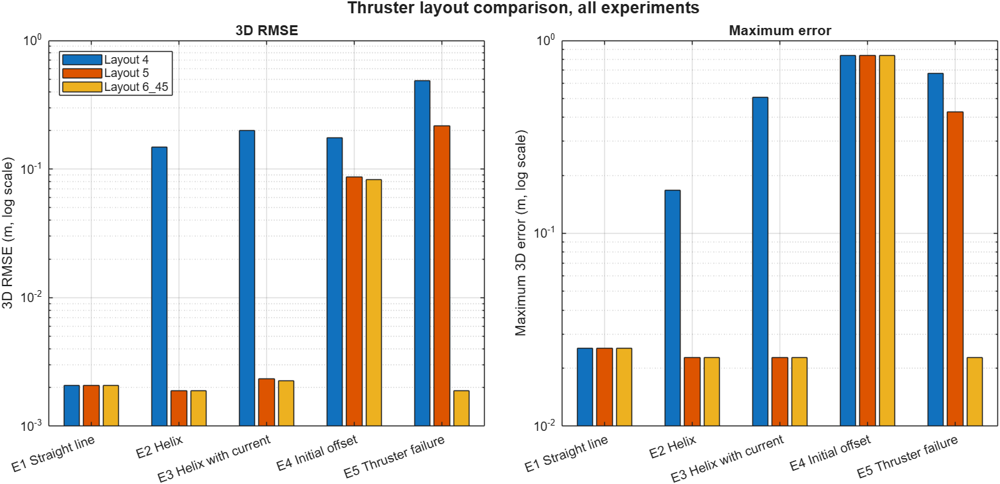
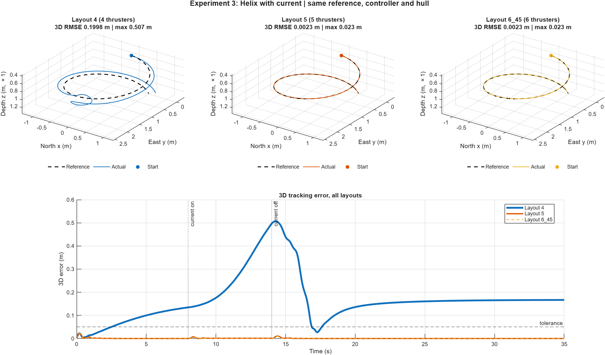
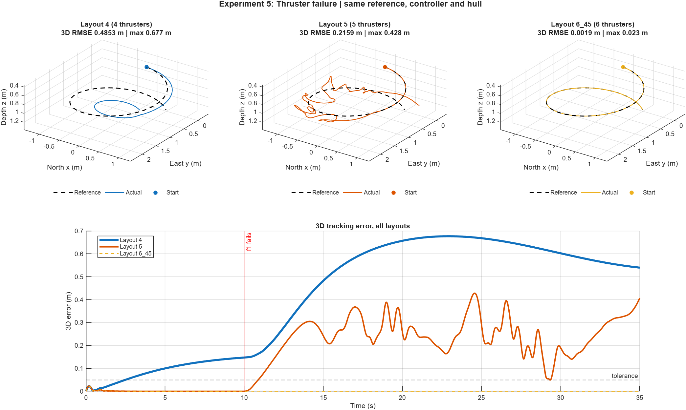
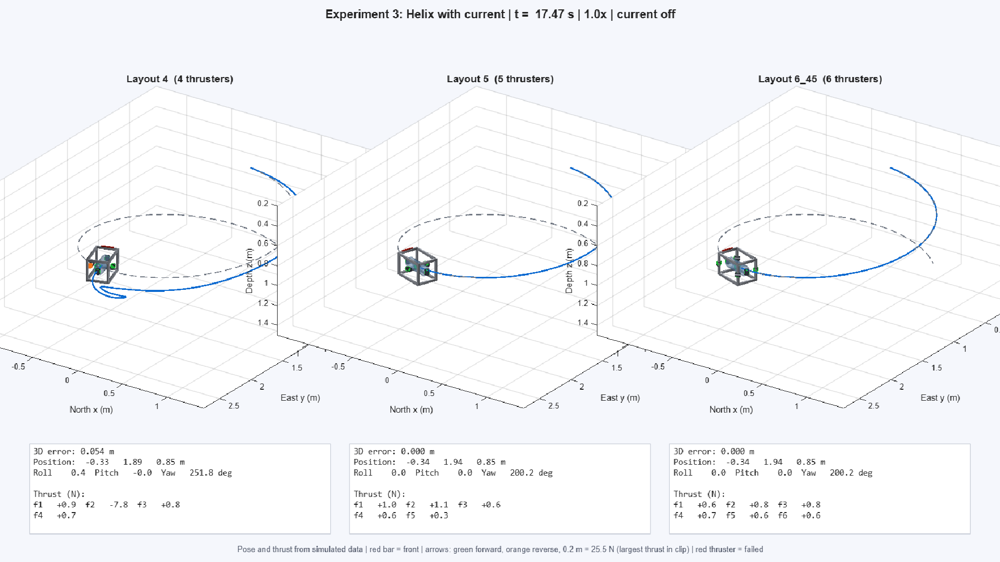
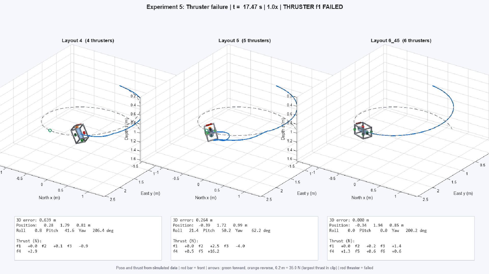

# ROV Thruster Configuration Study (MATLAB)

Effect of thruster **number and placement** on the manoeuvrability of a small underwater robot
(300 × 200 × 200 mm aluminium-extrusion frame, central tube). Hull, MPC weights and thruster
rating are identical across runs; only the thruster layout changes.

- Layouts: `4` (`cfg_4.m`), `5` (`cfg_5.m`), `6_45` (`cfg_6.m`, thrusters at 45°)
- Controller: linear MPC on thruster forces (box-constrained QP with disturbance estimate)
- Model: 6-DOF Fossen model, NED earth frame / FRD body frame, ZYX Euler angles
- Free-swimming vehicle (`c.tether = false` in `rov_config.m`)
- **Base MATLAB only**: no MPC, Optimization or Control toolbox needed

## Results



| Experiment | 4 thrusters | 5 thrusters | 6 @ 45° |
| --- | ---: | ---: | ---: |
| 1 Straight line | 0.0021 | 0.0021 | 0.0021 |
| 2 Helix | 0.1488 | 0.0019 | 0.0019 |
| 3 Helix with current | 0.1998 | 0.0023 | 0.0023 |
| 4 Initial offset | 0.1757 | 0.0873 | 0.0826 |
| 5 Thruster failure | 0.4853 | 0.2159 | 0.0019 |

3D RMSE in metres, 35 s runs. All three layouts track the straight line. The 4-thruster layout
cannot hold the helix. 5 and 6 thrusters behave the same until a thruster fails, and then only
the 6-thruster layout keeps tracking. See [`results/analysis.md`](results/analysis.md) for
the full tables and [`results/summary.csv`](results/summary.csv) for every metric.

| Experiment 3: helix with current | Experiment 5: thruster failure |
| --- | --- |
|  |  |

Per-run figures (3D path, position, error, thruster forces, body forces, attitude) are in
`results/<layout>/experiment_k.png`.

## Videos

Side-by-side 3D animations of all three layouts with live thrust arrows:

| Experiment 3: helix with current | Experiment 5: thruster failure |
| --- | --- |
| [](videos/experiment_3_4_vs_5_vs_6_45.mp4) | [](videos/experiment_5_4_vs_5_vs_6_45.mp4) |

Click a preview to open the MP4. The videos were rendered from an earlier run (26 Oct 2026),
so they can differ slightly from the figures above. Run `make_rov_video(k)` to regenerate them.

## Experiments (`rov_config.m`)

| # | Name | Condition |
| --- | --- | --- |
| 1 | Straight line | 0.22 m/s line, no disturbance |
| 2 | Helix | R = 1 m, 0.2 m/s, descending, heading tangent |
| 3 | Helix with current | 0.2 m/s side current on [8, 14) s |
| 4 | Initial offset | start [0.6 −0.5 0.3] m and 0.5 rad yaw off the path |
| 5 | Thruster failure | thruster f1 fails at 10 s, MPC informed |

To add `6_30` / `6_60` layouts or top-mounted placement (`c.z_off = -0.10`), edit `rov_config.m`.

## Run

From the repo root in MATLAB:

```matlab
[summary, runs] = run_rov_experiments;   % all layouts x 5 experiments -> results/
make_rov_video(3);                       % experiment 3, all layouts side by side (MP4)
make_rov_video(5, 'Layouts', {'4','6_45'});
make_rov_video('results/6_45/experiment_2.mat');
make_rov_video(4, 'PlaybackSpeed', 2, 'TimeRange', [0 15]);
compare_rov_results;                     % redraw comparison figures from saved data
analysis('geometry');                    % thrust-matrix / authority / failure tables
analysis('sanity');                      % open-loop model checks
```

The raw `.mat` data and `.fig` files are not in the repo (see `.gitignore`).
`run_rov_experiments` regenerates them, and `compare_rov_results` / `make_rov_video` need them.

## Metrics

Per-axis and 3D RMSE; max, final and initial error; IAE; convergence time (error stays within
0.05 m until the end); recovery after the current (within 0.05 m for 1 s); RMSE after failure;
max roll/pitch; thruster saturation fraction; control effort.

## Files

| File | Role |
| --- | --- |
| `rov_params.m` | Mass, inertia, added mass, damping, buoyancy, thruster limits (`[MEASURE]` / `[IDENTIFY]` = still to be measured) |
| `cfg_4.m`, `cfg_5.m`, `cfg_6.m` | Thruster positions / directions per layout |
| `tcm.m` | Thrust configuration matrix, τ = T f |
| `rov_dynamics.m`, `rov_kinematics.m` | 6-DOF model |
| `mpc_setup.m`, `mpc_step.m` | Linear MPC |
| `trajectories.m` | Reference paths |
| `run_sim.m` | One simulation (plant + MPC + thruster lag/failure) |
| `rov_config.m`, `run_rov_experiments.m`, `rov_metrics.m` | Experiment runner and metrics |
| `plot_rov_experiment.m`, `compare_rov_results.m` | Figures |
| `make_rov_video.m`, `create_rov_graphics.m` | MP4 animation |
| `analysis.m` | Geometry, sanity, step, turning, tracking, disturbance and failure test tables |

```
├── *.m                   MATLAB source
├── results/
│   ├── summary.csv, analysis.md, summary_rmse.png, compare_experiment_k.png
│   └── 4/ 5/ 6_45/       per-layout experiment_k.png
└── videos/               MP4 animations + preview frames
```

Part of the AUV7 capstone project (thruster-configuration subsystem).
